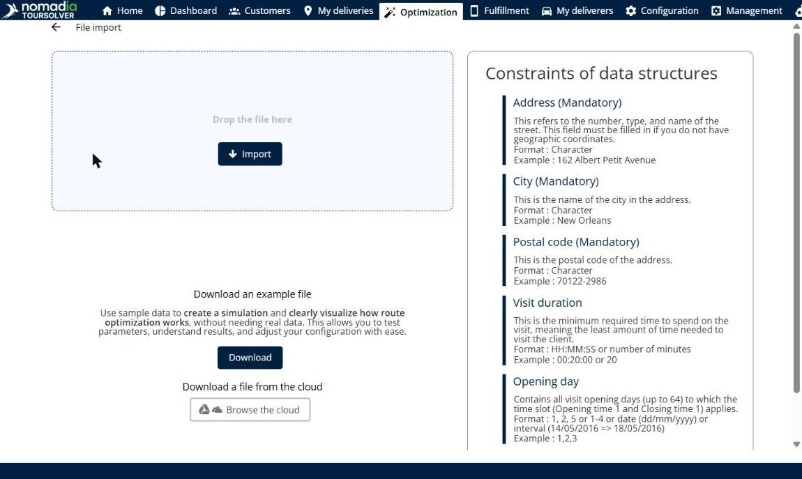

# Ajouter un fichier de livraisons

Cette page explique comment importer un fichier de livraisons dans une simulation.

## Avant de commencer

* Ouvrez une simulation. Voir [Simulation](simulation.md).
* Préparez un fichier de livraisons. La liste **Contraintes des structures de données** de la page d’importation décrit chaque colonne.

## Étapes

1. Accédez à **Simulation** > **Livraisons**.
2. Cliquez sur la flèche déroulante **Livraisons**, puis sur **Ajouter un fichier de livraisons**. Vous pouvez aussi appuyer sur **Alt+f**.
3. Sur la page **Importation de fichier**, déposez votre fichier dans la zone **Déposer le fichier ici**, ou cliquez sur **Importer** et sélectionnez le fichier.
4. Pour importer un fichier depuis votre stockage dans le cloud, cliquez sur **Parcourir le cloud**.
5. Suivez les étapes de l’importation pour la terminer.

Cliquez sur la flèche de retour en haut à gauche pour revenir à la simulation sans importer de fichier.

## Options et champs

| Option ou champ | Ce que cela fait | Remarques |
|---|---|---|
| **Déposer le fichier ici** / **Importer** | Importe votre fichier. | |
| **Télécharger** | Télécharge un exemple de fichier. | Utilisez des données d’exemple pour créer une simulation et voir comment fonctionne l’optimisation des tournées, sans données réelles. |
| **Parcourir le cloud** | Importe un fichier depuis votre stockage dans le cloud. | |
| **Contraintes des structures de données** | Décrit chaque colonne du fichier, avec son format et un exemple. | **Adresse**, **Ville** et **Code postal** sont obligatoires. L’adresse n’est pas nécessaire si le fichier contient des coordonnées géographiques. |

## Résultat

Les livraisons du fichier sont ajoutées au panneau **Livraisons**.

## Rubriques connexes

* [Gérer les livraisons](simulation-deliveries.md)
* [Import of Deliveries](../importanddatasetup/importanddatasetup-importofdeliveries.md)
