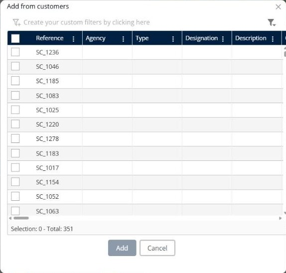

# Ajouter depuis les clients

Cette page explique comment ajouter des livraisons à une simulation à partir de votre liste de clients.

## Avant de commencer

* Ouvrez une simulation. Voir [Simulation](simulation.md).
* Vérifiez que les clients existent dans l’onglet **Clients**.

## Étapes

1. Accédez à **Simulation** > **Livraisons**.
2. Cliquez sur la flèche déroulante **Livraisons**, puis sur **Ajouter depuis les clients**.
3. Dans la fenêtre **Ajouter depuis les clients**, retrouvez les clients. Les colonnes comprennent **Référence**, **Agence**, **Type**, **Désignation** et **Description**. Pour filtrer la liste, cliquez sur **Créez vos filtres personnalisés en cliquant ici**.
4. Cochez les cases des clients que vous souhaitez ajouter.
5. Cliquez sur **Ajouter**.

Cliquez sur **Annuler** pour fermer la fenêtre sans ajouter de livraison.

## Résultat

Une livraison est ajoutée au panneau **Livraisons** pour chaque client sélectionné. Le pied de page de la fenêtre indique le nombre de clients sélectionnés et le total, par exemple **Sélection : 0 - Total : 351**.

## Rubriques connexes

* [Gérer les livraisons](simulation-deliveries.md)
* [Ajouter une livraison](simulation-deliveries-add-delivery.md)
