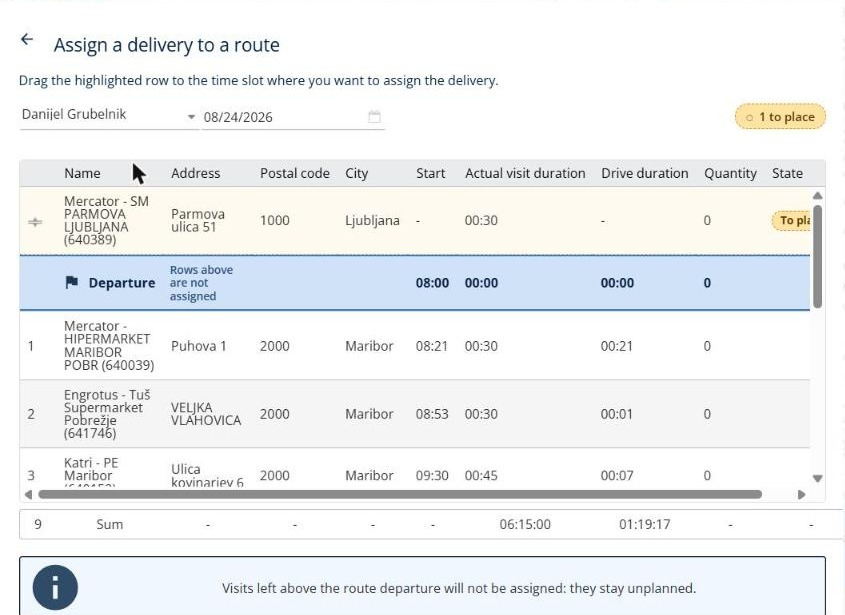

# Affecter des livraisons à une tournée

Cette page explique comment choisir la tournée et le créneau d’une livraison.

## Avant de commencer

* Ouvrez une simulation. Voir [Simulation](simulation.md).

## Étapes

1. Accédez à **Simulation** > **Livraisons**.
2. Cochez la case de la livraison que vous souhaitez affecter.
3. Cliquez sur la flèche déroulante **Livraisons**, puis sur **Affecter des livraisons**.
4. Sur la page **Affecter une livraison à une tournée**, sélectionnez le livreur dans la première liste, par exemple **Danijel Grubelnik**, et le jour dans le champ de date.
5. Lisez l’instruction en haut de la page : **Glissez la ligne mise en évidence au créneau où vous souhaitez affecter la livraison.** La ligne mise en évidence correspond à votre livraison, et le badge en haut à droite indique le nombre de livraisons restant à placer, par exemple **1 à placer**. Le tableau liste le **Départ** et les arrêts de la tournée, avec le **Nom**, l’**Adresse**, le **Code postal**, la **Ville/Commune**, le **Départ**, la **Durée réelle de visite**, la **Durée de conduite**, la **Quantité** et l’**État** de chaque arrêt. La dernière ligne affiche les totaux.
6. Faites glisser la ligne mise en évidence vers la position souhaitée pour la livraison dans la tournée.
7. Cliquez sur la flèche de retour en haut à gauche pour revenir à la simulation.

La carte située à droite de la page affiche la tournée.

## Résultat

Vous pouvez vérifier la livraison dans les colonnes **Planifié**, **Affecté à**, **Jour planifié** et **Heure planifiée** du panneau **Livraisons**.

## Conseils


**Livraisons au-dessus du départ** : les lignes situées au-dessus du départ de la tournée ne sont pas affectées. Elles restent non planifiées.


## Rubriques connexes

* [Gérer les livraisons](simulation-deliveries.md)
* [Désaffecter des livraisons](simulation-deliveries-unassign.md)
* [Afficher une tournée](simulation-routes-view-route.md)
