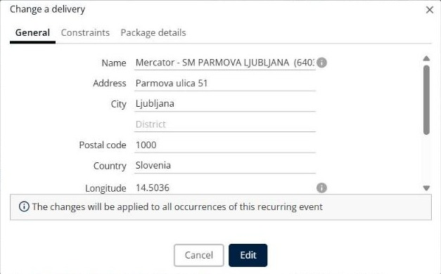

# Modifier une livraison

Cette page explique comment modifier les informations d’une livraison dans une simulation.

## Avant de commencer

* Ouvrez une simulation. Voir [Simulation](simulation.md).

## Étapes

1. Accédez à **Simulation** > **Livraisons**.
2. Cochez la case de la livraison que vous souhaitez modifier.
3. Cliquez sur la flèche déroulante **Livraisons**, puis sur **Modifier une livraison**. Vous pouvez aussi appuyer sur **Alt+c**, ou cliquer sur l’icône en forme de crayon au début de la ligne.
4. Dans la fenêtre **Modifier une livraison**, modifiez les champs des onglets **Général**, **Contraintes** et **Détails des colis**. Les champs sont les mêmes que dans [Ajouter une livraison](simulation-deliveries-add-delivery.md).
5. Cliquez sur **Modifier**.

Cliquez sur **Annuler** pour fermer la fenêtre sans enregistrer vos modifications.

## Résultat

La livraison affiche vos modifications dans le panneau **Livraisons**.

## Conseils


**Livraisons récurrentes** : pour une livraison avec une fréquence, le message **Les changements seront appliqués à toutes les occurrences de cet événement récurrent** s’affiche. Vos modifications s’appliquent à chaque occurrence de la livraison.


## Rubriques connexes

* [Gérer les livraisons](simulation-deliveries.md)
* [Ajouter une livraison](simulation-deliveries-add-delivery.md)
