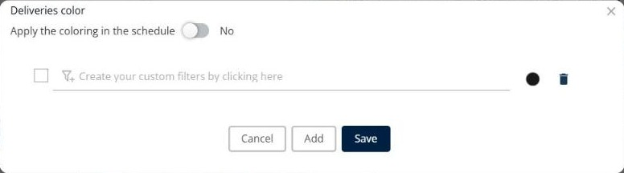

# Colorer les livraisons

Cette page explique comment utiliser **Coloration** pour appliquer des règles de couleur aux livraisons.

## Quand l’utiliser

Utilisez **Coloration** pour attribuer une couleur aux livraisons selon une règle, par exemple une couleur par livreur. Les couleurs permettent de voir plus facilement quelles livraisons vont ensemble.

## Avant de commencer

* Ouvrez une simulation. Voir [Simulation](simulation.md).

## Étapes

1. Accédez à **Simulation** > **Livraisons**.
2. Cliquez sur la flèche déroulante **Livraisons**, puis sur **Coloration**.
3. Dans la fenêtre **Coloration des livraisons**, chaque ligne est une règle comportant une condition et une couleur.
4. Pour créer la condition d’une règle, cliquez sur **Créez vos filtres personnalisés en cliquant ici**, par exemple **Affecté à = "Danijel Grubelnik"**.
5. Cliquez sur la pastille de couleur pour choisir la couleur de la règle.
6. Cochez la case au début d’une règle pour l’utiliser.
7. Pour supprimer une règle, cliquez sur l’icône de corbeille à la fin de la ligne.
8. Pour créer une autre règle, cliquez sur **Ajouter**.
9. Pour afficher également les couleurs dans le planning, activez **Appliquer la coloration dans le planning**.
10. Cliquez sur **Enregistrer**.

Cliquez sur **Annuler** pour fermer la fenêtre sans enregistrer.

## Options et champs

| Option ou champ | Ce que cela fait | Remarques |
|---|---|---|
| **Appliquer la coloration dans le planning** | Affiche les couleurs dans le planning. | L’interrupteur affiche **Non** par défaut. |
| Case à cocher de la règle | Active ou désactive une règle. | Seules les règles cochées colorent les livraisons. |
| Condition de la règle | Définit quelles livraisons reçoivent la couleur. | Cliquez sur **Créez vos filtres personnalisés en cliquant ici** pour la créer. |
| Pastille de couleur | Affiche et modifie la couleur de la règle. | |
| Icône de corbeille | Supprime la règle. | |
| **Ajouter** | Ajoute une nouvelle règle. | |
| **Enregistrer** | Enregistre les règles. | |
| **Annuler** | Ferme la fenêtre sans enregistrer. | |

## Résultat

Les livraisons qui correspondent à une règle cochée reçoivent la couleur de cette règle.

## Rubriques connexes

* [Gérer les livraisons](simulation-deliveries.md)
* [Personnaliser la liste des livraisons](simulation-deliveries-customize-list.md)
