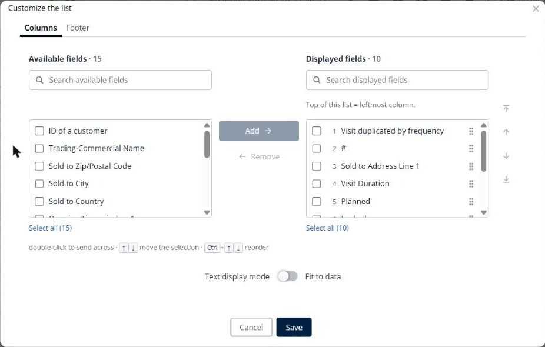

# Personnaliser la liste des livraisons

Cette page explique comment choisir les colonnes du panneau **Livraisons** et créer vos propres filtres.

## Avant de commencer

* Ouvrez une simulation. Voir [Simulation](simulation.md).

## Choisir les colonnes

1. Accédez à **Simulation** > **Livraisons**.
2. Cliquez sur la flèche déroulante **Livraisons**, puis sur **Personnaliser la liste**.
3. Dans l’onglet **Colonnes**, sélectionnez un ou plusieurs champs dans **Champs disponibles**, puis cliquez sur **Ajouter**. Pour trouver un champ, saisissez son nom dans la zone de recherche.
4. Pour supprimer une colonne, sélectionnez-la dans **Champs affichés**, puis cliquez sur **Retirer**.
5. Pour modifier l’ordre des colonnes, sélectionnez un champ dans **Champs affichés**, puis cliquez sur les flèches à droite, ou faites glisser le champ par sa poignée. Le haut de la liste correspond à la colonne la plus à gauche.
6. Facultatif : activez **Mode d’affichage du texte** pour sélectionner **Ajuster aux données**.
7. Cliquez sur **Enregistrer**.

Utilisez l’onglet **Pied de page** pour définir le pied de page du tableau. Cliquez sur **Annuler** pour fermer la fenêtre sans enregistrer.

## Filtrer la liste

* Cliquez sur **Créez vos filtres personnalisés en cliquant ici** en haut du panneau pour créer un filtre personnalisé.
* Cliquez sur l’icône de filtre de la ligne d’en-tête pour afficher la ligne de filtre et filtrer par colonne.

## Résultat

Le panneau **Livraisons** affiche vos colonnes et vos filtres.

## Conseils


**Raccourcis clavier** : double-cliquez sur un champ pour changer de liste. Utilisez les flèches haut et bas pour déplacer la sélection, et **Ctrl** avec une flèche pour réordonner les champs.


## Rubriques connexes

* [Gérer les livraisons](simulation-deliveries.md)
* [Colorer les livraisons](simulation-deliveries-coloring.md)
* [Personnaliser la liste des tournées](simulation-routes-customize-list.md)
