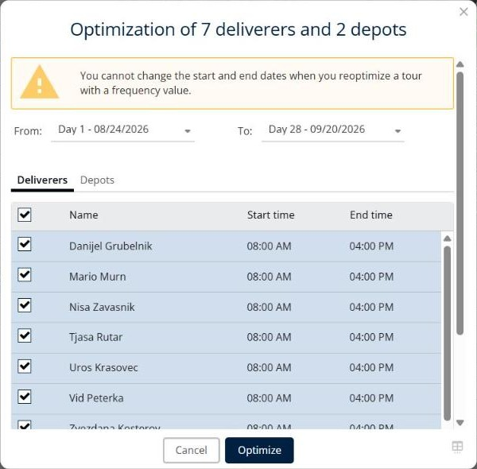
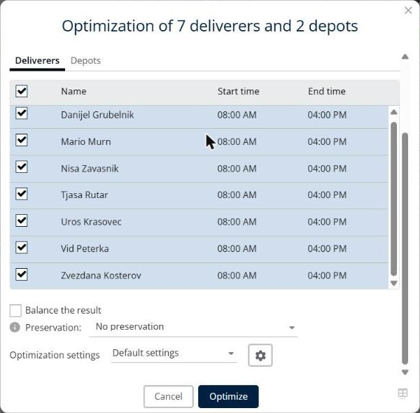

# Optimiser les livraisons

Cette page explique comment optimiser les livraisons sélectionnées dans une simulation.

## Avant de commencer

* Ouvrez une simulation. Voir [Simulation](simulation.md).

## Quand l’utiliser

Utilisez **Optimiser** pour planifier automatiquement les livraisons sélectionnées. Vous choisissez les dates, les livreurs et les dépôts, vous pouvez équilibrer la charge de travail et conserver les tournées existantes, et vous sélectionnez un profil de paramètres.

## Étapes

1. Accédez à **Simulation** > **Livraisons**.
2. Cochez les cases des livraisons que vous souhaitez optimiser.
3. Cliquez sur la flèche déroulante **Livraisons**, puis sur **Optimiser**. Vous pouvez aussi cliquer sur **Optimiser** dans la barre d’outils, ou appuyer sur **Ctrl+o**.
4. Dans la fenêtre **Optimisation de … livreurs et de … dépôts**, sélectionnez le premier et le dernier jour de la période dans **Du** et **Au**, par exemple **Jour 1 - 08/24/2026** et **Jour 28 - 09/20/2026**.
5. Dans l’onglet **Livreurs**, sélectionnez les livreurs à utiliser. La liste affiche le **Nom**, l’**Heure de début** et l’**Heure de fin** de chaque livreur. Cochez la case de la ligne d’en-tête pour sélectionner tous les livreurs.
6. Dans l’onglet **Dépôts**, sélectionnez les dépôts à utiliser.
7. Facultatif : cochez **Équilibrer le résultat**.
8. Dans **Préservation**, sélectionnez ce que vous souhaitez conserver des tournées actuelles.
9. Dans **Paramètres d’optimisation**, sélectionnez la configuration à utiliser, par exemple **Paramètres par défaut**. Pour consulter ou modifier les paramètres, cliquez sur le bouton en forme d’engrenage. Voir [Configurer les paramètres d’optimisation](simulation-optimization-settings.md).
10. Cliquez sur **Optimiser**.

## Options et champs

| Option ou champ | Ce que cela fait | Remarques |
|---|---|---|
| **Du** et **Au** | Définissent le premier et le dernier jour de la période. | Par exemple **Jour 1 - 08/24/2026** et **Jour 28 - 09/20/2026**. |
| **Livreurs** | Liste les livreurs avec leur **Nom**, leur **Heure de début** et leur **Heure de fin**. | Cochez la case de chaque livreur à utiliser. La case de l’en-tête sélectionne tous les livreurs. |
| **Dépôts** | Liste les dépôts. | Sélectionnez les dépôts à utiliser. |
| **Équilibrer le résultat** | Équilibre la charge de travail entre les livreurs. | Non cochée par défaut. |
| **Préservation** | Choisit ce qui est conservé des tournées actuelles : **Pas de préservation**, **Préserver les tournées** ou **Préserver l’ordre des tournées**. | La valeur par défaut est **Pas de préservation**. Cliquez sur l’icône d’information pour plus de détails. |
| **Paramètres d’optimisation** | Sélectionne le profil de paramètres à utiliser. | La valeur par défaut est **Paramètres par défaut**. Le bouton en forme d’engrenage ouvre les paramètres. |
| **Annuler** | Ferme la fenêtre sans optimiser. | |
| **Optimiser** | Lance l’optimisation. | |

## Résultat

Les livraisons sont optimisées et le panneau **Détails** met à jour ses totaux. Lorsque l’optimisation est terminée, la fenêtre **Résultats de l’optimisation** s’ouvre. Voir [Simulation](simulation.md).

## Conseils


**Livraisons avec une fréquence** : vous ne pouvez pas changer les dates de début et de fin lorsque vous réoptimisez une tournée avec une valeur de fréquence.



**Sélectionnez d’abord des livraisons** : si aucune livraison n’est sélectionnée, l’action n’a aucun effet.


## Rubriques connexes

* [Gérer les livraisons](simulation-deliveries.md)
* [Configurer les paramètres d’optimisation](simulation-optimization-settings.md)
* [Ordonner une tournée](simulation-deliveries-single-route-ordering.md)
