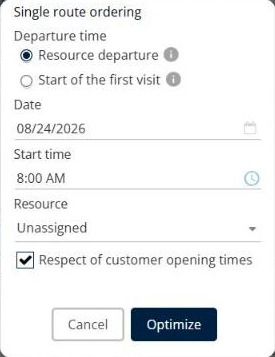

# Ordonner une tournée

Cette page explique comment utiliser **Ordonner une tournée** pour construire une séquence optimisée unique avec les livraisons que vous sélectionnez.

## Quand l’utiliser

Utilisez **Ordonner une tournée** lorsque vous souhaitez placer les livraisons sélectionnées sur une seule tournée, dans le meilleur ordre. La séquence démarre au départ du livreur ou à la première visite, et elle respecte les horaires d’ouverture de vos clients.

## Avant de commencer

* Ouvrez une simulation. Voir [Simulation](simulation.md).
* Sélectionnez les livraisons que vous souhaitez ordonner.

## Étapes

1. Accédez à **Simulation** > **Livraisons**.
2. Cochez les cases des livraisons que vous souhaitez ordonner.
3. Cliquez sur la flèche déroulante **Livraisons**, puis sur **Ordonner une tournée**. Vous pouvez aussi appuyer sur **Alt+t**.
4. Dans **Heure de départ**, sélectionnez **Départ de la ressource** ou **Début de la première visite**.
5. Dans **Date**, sélectionnez le jour de la tournée, par exemple **08/24/2026**.
6. Dans **Heure de début**, sélectionnez l’heure de début de la tournée, par exemple **8:00 AM**.
7. Dans **Ressource**, sélectionnez le livreur qui effectue la tournée. La valeur par défaut est **Non affectée**.
8. Laissez **Respect des horaires d’ouverture des clients** coché pour respecter les horaires d’ouverture de vos clients.
9. Cliquez sur **Optimiser**.

Cliquez sur **Annuler** pour fermer la fenêtre sans ordonner la tournée.

## Options et champs

| Option ou champ | Ce que cela fait | Remarques |
|---|---|---|
| **Départ de la ressource** | Démarre la séquence au départ du livreur. | Sélectionné par défaut. Cliquez sur l’icône d’information située à côté pour plus de détails. |
| **Début de la première visite** | Démarre la séquence à la première visite. | Cliquez sur l’icône d’information située à côté pour plus de détails. |
| **Date** | Définit le jour de la tournée. | Utilisez l’icône de calendrier pour choisir une date. |
| **Heure de début** | Définit l’heure de début de la tournée. | Utilisez l’icône d’horloge pour choisir une heure. |
| **Ressource** | Définit le livreur de la tournée. | La valeur par défaut est **Non affectée**. |
| **Respect des horaires d’ouverture des clients** | Respecte les horaires d’ouverture de vos clients lors de la construction de la séquence. | Sélectionné par défaut. |

## Résultat

Les livraisons sélectionnées sont ordonnées sur une seule tournée.

Si l’action concerne uniquement des tournées verrouillées, rien ne change. Pour modifier une tournée verrouillée, déverrouillez-la d’abord. Voir [Verrouiller et déverrouiller des tournées](simulation-routes-lock-unlock.md).

## Rubriques connexes

* [Gérer les livraisons](simulation-deliveries.md)
* [Optimiser les livraisons](simulation-deliveries-optimize.md)
* [Verrouiller et déverrouiller des livraisons](simulation-deliveries-lock-unlock.md)
