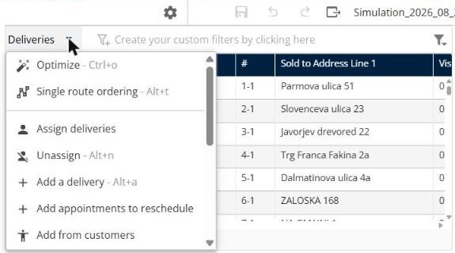
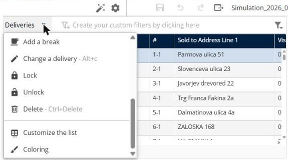

# Gérer les livraisons

Cette page explique comment utiliser le panneau **Livraisons** pour retrouver des livraisons dans une simulation et modifier leur planification.

## Avant de commencer

* Ouvrez une simulation. Voir [Simulation](simulation.md).

## Colonnes

Le panneau affiche une ligne par livraison. Par défaut, les colonnes comprennent **Visite dupliquée via la fréquence**, **#**, **Sold to Address Line 1**, **Visit Duration**, **Planifié**, **Verrouillé**, **Raison**, **Affecté à**, **Jour planifié** et **Heure planifiée**. Pour choisir d’autres colonnes, voir [Personnaliser la liste des livraisons](simulation-deliveries-customize-list.md).

## Étapes

1. Accédez à **Simulation** > **Livraisons**.
2. Cliquez sur **Créez vos filtres personnalisés en cliquant ici** pour filtrer la liste.
3. Cochez les cases des livraisons que vous souhaitez modifier.
4. Cliquez sur la flèche déroulante **Livraisons**. Le menu liste **Optimiser**, **Ordonner une tournée**, **Affecter des livraisons**, **Désaffecter**, **Ajouter une livraison**, **Ajouter des rendez-vous à replanifier**, **Ajouter depuis les clients**, **Ajouter un fichier de livraisons**, **Ajouter une pause**, **Modifier une livraison**, **Verrouiller**, **Déverrouiller**, **Supprimer**, **Personnaliser la liste** et **Coloration**.
5. Cliquez sur une action. Chaque action est décrite dans sa propre rubrique, listée sous **Fonctionnalités**.

## Fonctionnalités

* [Optimiser les livraisons](simulation-deliveries-optimize.md) : optimisez les livraisons sélectionnées sur une période, avec les livreurs de votre choix.
* [Ordonner une tournée](simulation-deliveries-single-route-ordering.md) : ordonnez les livraisons sélectionnées sur une seule tournée.
* [Affecter des livraisons à une tournée](simulation-deliveries-assign.md) : choisissez la tournée et le créneau d’une livraison.
* [Désaffecter des livraisons](simulation-deliveries-unassign.md) : retirez les livraisons sélectionnées de leurs tournées.
* [Ajouter une livraison](simulation-deliveries-add-delivery.md) : créez une nouvelle livraison dans la simulation.
* [Ajouter des rendez-vous à replanifier](simulation-deliveries-add-appointments-to-reschedule.md) : ajoutez à la simulation les rendez-vous à replanifier.
* [Ajouter depuis les clients](simulation-deliveries-add-from-customers.md) : ajoutez des livraisons à partir de votre liste de clients.
* [Ajouter un fichier de livraisons](simulation-deliveries-add-file-of-deliveries.md) : importez un fichier de livraisons dans la simulation.
* [Ajouter une pause](simulation-deliveries-add-break.md) : ajoutez une pause à une tournée.
* [Modifier une livraison](simulation-deliveries-change-delivery.md) : modifiez les informations d’une livraison.
* [Verrouiller et déverrouiller des livraisons](simulation-deliveries-lock-unlock.md) : conservez les livraisons en l’état, ou rendez-les à nouveau modifiables.
* [Supprimer des livraisons](simulation-deliveries-delete.md) : retirez les livraisons sélectionnées de la simulation.
* [Personnaliser la liste des livraisons](simulation-deliveries-customize-list.md) : choisissez les colonnes et créez des filtres.
* [Colorer les livraisons](simulation-deliveries-coloring.md) : appliquez des règles de couleur, comme une couleur par livreur.

## Résultat

Le pied de page indique le nombre de livraisons sélectionnées et le total, par exemple **Sélection : 2 - Total : 1032**.

## Conseils


**Raccourcis clavier** : le menu affiche le raccourci de chaque action, par exemple **Ctrl+o** pour **Optimiser**, **Alt+t** pour **Ordonner une tournée** et **Alt+a** pour **Ajouter une livraison**.


## Rubriques connexes

* [Simulation](simulation.md)
* [Gérer les tournées](simulation-routes.md)
* [Afficher la carte](simulation-map.md)
