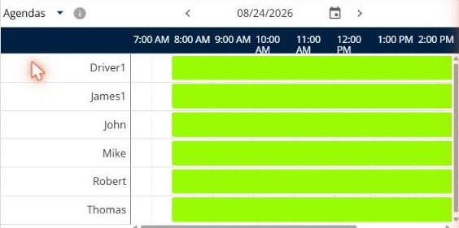
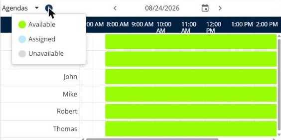

# Consulter les plannings

Cette page explique comment utiliser la vue **Plannings** pour voir quand vos livreurs sont disponibles.

## Avant de commencer

* Ouvrez une simulation. Voir [Simulation](simulation.md).

## Étapes

1. Accédez à **Simulation** > **Détails**.
2. Cliquez sur la flèche déroulante **Détails**, puis sur **Plannings**.
3. Lisez la chronologie. Chaque ligne correspond à un livreur, par exemple **Driver1** ou **John**, et les heures de la journée figurent en haut.
4. Pour changer de jour, cliquez sur les flèches de chaque côté de la date, ou cliquez sur l’icône de calendrier.
5. Pour voir la signification des couleurs, cliquez sur l’icône d’information à côté du titre du panneau.

## Résultat

Les couleurs indiquent les livreurs disponibles (vert), affectés (bleu) et indisponibles (gris).

## Rubriques connexes

* [Consulter les détails d’une tournée](simulation-details.md)
* [Gérer les tournées](simulation-routes.md)
