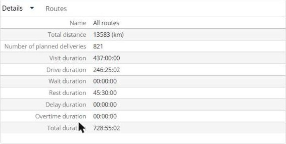

# Consulter les détails d’une tournée

Cette page explique comment utiliser le panneau **Détails** pour consulter les totaux de vos tournées.

## Avant de commencer

* Ouvrez une simulation. Voir [Simulation](simulation.md).

## Étapes

1. Accédez à **Simulation** > **Détails**.
2. Cliquez sur la flèche déroulante **Détails**.
3. Cliquez sur **Détails** pour consulter les totaux, ou sur **Plannings** pour consulter les plannings. Voir [Consulter les plannings](simulation-details-agendas.md).
4. Pour consulter les totaux d’une tournée, ouvrez la tournée dans le panneau **Tournées**. Voir [Afficher une tournée](simulation-routes-view-route.md).

## Fonctionnalités

* [Consulter les plannings](simulation-details-agendas.md) : voyez quand vos livreurs sont disponibles, affectés ou indisponibles.

## Résultat

La vue **Détails** affiche **Nom**, **Distance totale**, **Nombre de livraisons planifiées**, **Durée de visite**, **Durée de conduite**, **Durée d’attente**, **Durée de repos**, **Durée de retard**, **Durée d’heures supplémentaires** et **Durée totale**. Lorsqu’aucune tournée n’est sélectionnée, **Nom** affiche **Toutes les tournées**. Lorsque vous ouvrez une tournée, le titre du panneau devient la tournée, par exemple **Tournée Danijel Grubelnik 08/24/2026**, et le panneau affiche cette tournée dans les onglets **Information**, **Essentiel** et **Autres**.

## Rubriques connexes

* [Simulation](simulation.md)
* [Gérer les tournées](simulation-routes.md)
* [Afficher une tournée](simulation-routes-view-route.md)
