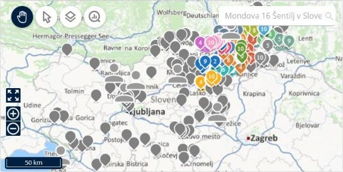

# Afficher la carte

Cette page explique comment utiliser le panneau **Carte** pour voir où se trouvent vos livraisons et vos tournées.

## Avant de commencer

* Ouvrez une simulation. Voir [Simulation](simulation.md).

## Étapes

1. Accédez à **Simulation** > **Carte**.
2. Cliquez sur **Navigation** pour vous déplacer sur la carte.
3. Cliquez sur **Sélection** pour sélectionner des livraisons sur la carte.
4. Cliquez sur **Visibilité des objets** pour choisir ce que la carte affiche. Voir [Choisir ce qu’affiche la carte](simulation-map-objects-visibility.md).
5. Cliquez sur **Information graphique** pour afficher plus de détails sur la carte. Voir [Utiliser l’information graphique](simulation-map-graphical-information.md).
6. Saisissez une adresse dans la zone de recherche pour trouver un lieu.
7. Utilisez les boutons de zoom avant et de zoom arrière pour modifier le niveau de zoom, ou le bouton plein écran pour agrandir la carte.

## Fonctionnalités

* [Choisir ce qu’affiche la carte](simulation-map-objects-visibility.md) : affichez ou masquez les tournées, les livraisons et les livreurs, et choisissez un style de carte.
* [Utiliser l’information graphique](simulation-map-graphical-information.md) : activez la coloration ou la densité sur la carte.

## Résultat

La carte affiche chaque tournée dans sa propre couleur. Des repères numérotés indiquent l’ordre des livraisons sur chaque tournée. Lorsque vous ouvrez une tournée, la carte zoome sur cette tournée.

## Conseils


**Tournées sur la carte** : seules les 20 premières tournées s’affichent sur la carte par défaut. Pour afficher une autre tournée, cliquez sur l’icône en forme d’œil de la tournée dans le panneau **Tournées**.


## Rubriques connexes

* [Simulation](simulation.md)
* [Gérer les livraisons](simulation-deliveries.md)
* [Gérer les tournées](simulation-routes.md)
