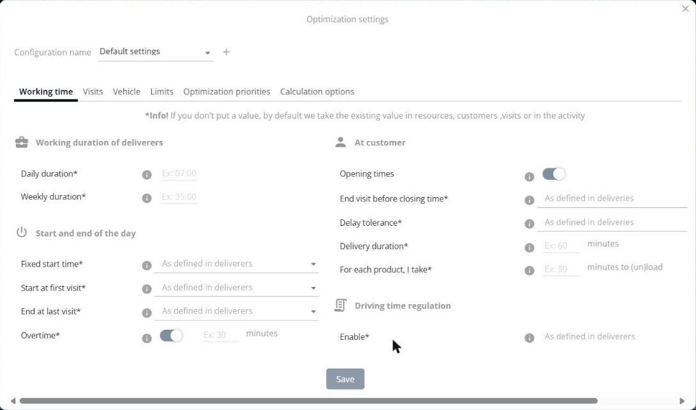
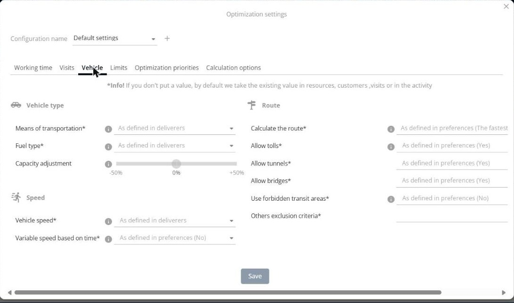
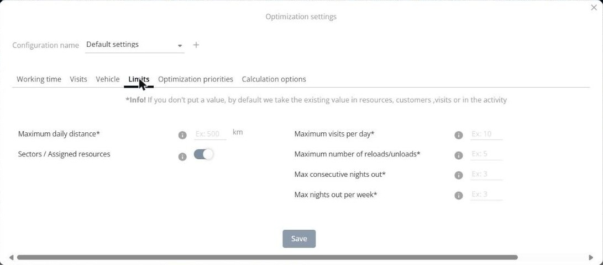
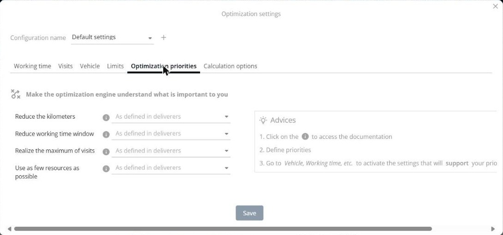
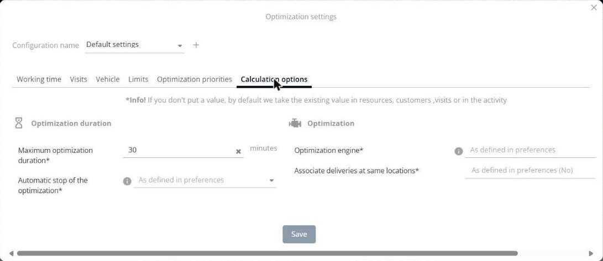

# Configurer les paramètres d’optimisation

Cette page explique comment utiliser la fenêtre **Paramètres d’optimisation** pour définir les paramètres utilisés par une optimisation.

## Avant de commencer

* Ouvrez une simulation. Voir [Simulation](simulation.md).

## Étapes

1. Ouvrez la fenêtre d’optimisation. Voir [Optimiser les livraisons](simulation-deliveries-optimize.md).
2. Cliquez sur le bouton en forme d’engrenage situé à côté de **Paramètres d’optimisation**.
3. Dans **Nom de la configuration**, sélectionnez une configuration, ou cliquez sur **+** pour en créer une nouvelle.
4. Ouvrez un onglet et saisissez vos valeurs. Les onglets sont décrits ci-dessous.
5. Cliquez sur **Enregistrer**.

Vous pouvez aussi ouvrir les paramètres avec le bouton **Voir et modifier les paramètres** de la barre d’outils.

Si vous ne mettez pas de valeur, l’optimisation reprend la valeur existante dans les ressources, les clients, les visites ou l’activité.

## Temps de travail

* **Durée de travail des livreurs** : **Durée quotidienne** et **Durée hebdomadaire**.
* **Début et fin de journée** : **Heure de départ fixe**, **Départ à la première visite**, **Arrivée à la dernière visite**, **Heures supplémentaires** (un interrupteur et un nombre de minutes), **Durée de briefing** et **Durée de débriefing** (en minutes).
* **Chez le client** : **Horaires d’ouverture** (un interrupteur), **Terminer la visite avant la fermeture**, **Tolérance au retard**, **Durée de la livraison** (en minutes) et **Pour chaque produit, je prends** … **minutes à (dé)charger**.
* **Réglementation du temps de conduite** : **Activer**.

## Visites

* **Ignorer le coût de sous-traitance** : un interrupteur.

## Véhicule

* **Type de véhicule** : **Moyen de transport**, **Carburant** et **Ajustement des capacités** (un curseur de -50 % à +50 %).
* **Vitesse** : **Vitesse du véhicule** et **Vitesse variable selon l’heure**.
* **Itinéraire** : **Calculer l’itinéraire**, **Autoriser les péages**, **Autoriser les tunnels**, **Autoriser les ponts**, **Prise en compte des zones de transit interdit** et **Autres critères d’exclusions**.

## Limites

* **Distance quotidienne maximale** (en km).
* **Secteurs / Ressources affectées** : un interrupteur.
* **Maximum de visites par jour**.
* **Nombre maximum de rechargements/déchargements**.
* **Maximum de nuitées consécutives** et **Maximum de nuitées par semaine**.

## Priorité d’optimisation

Utilisez cet onglet pour faire comprendre au moteur d’optimisation ce qui est important pour vous. Définissez une valeur pour chaque priorité :

* **Réduire les kilomètres**.
* **Réduire la plage de travail**.
* **Réaliser le maximum de visites**.
* **Utiliser le moins de ressources possible**.

La zone **Conseils** propose trois étapes : cliquez sur l’icône d’information pour accéder à la documentation, définissez vos priorités, puis allez dans des onglets tels que **Véhicule** et **Temps de travail** pour activer les paramètres qui appuieront vos priorités.

## Options de calcul

* **Durée de l’optimisation** : **Durée maximale d’optimisation** (en minutes) et **Arrêt automatique de l’optimisation**.
* **Optimisation** : **Moteur d’optimisation** et **Associer les livraisons de même localisation**.

## Résultat

Vos valeurs sont enregistrées dans la configuration que vous avez sélectionnée.

## Conseils


**Icônes d’information** : cliquez sur l’icône d’information située à côté d’un paramètre pour en savoir plus.


## Rubriques connexes

* [Optimiser les livraisons](simulation-deliveries-optimize.md)
* [Gérer les livraisons](simulation-deliveries.md)
* [FAQ: How to Prioritize the Fewest Possible km / the Most Planned Customers?](../faq/how-to-prioritize-the-fewest-possible-km-the-most-planned-customers.md)
