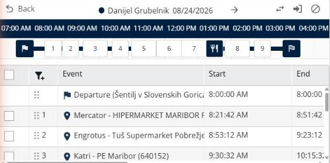
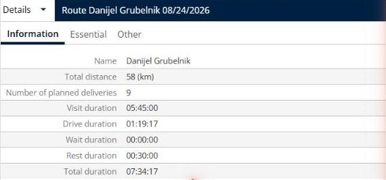

# Afficher une tournée

Cette page explique comment ouvrir une tournée pour voir ses arrêts, ses horaires et ses totaux.

## Avant de commencer

* Ouvrez une simulation. Voir [Simulation](simulation.md).

## Étapes

1. Accédez à **Simulation** > **Tournées**.
2. Cliquez sur la ligne d’une tournée. Le panneau affiche la tournée, la carte zoome sur elle, et le panneau **Détails** affiche ses totaux.
3. Lisez le titre en haut du panneau. Il indique le livreur et la date de la tournée, par exemple **Danijel Grubelnik 08/24/2026**. Cliquez sur la flèche à côté pour passer à la tournée suivante.
4. Lisez la chronologie. Elle commence par le drapeau de départ, affiche les arrêts numérotés et l’icône de la pause déjeuner, et se termine par le drapeau d’arrivée. Pointez un arrêt pour voir son nom et son créneau.
5. Lisez le tableau sous la chronologie. Il liste les événements de la tournée dans l’ordre, avec leur **Départ**, leur **Fin**, leur **Durée**, leur **Durée de conduite**, leur **Distance**, leur **État** et leur adresse. Le premier événement est le **Départ** et le dernier est l’**Arrivée**.
6. Utilisez les boutons en haut à droite du panneau :
   * **Inverser** : inversez l’ordre de la tournée.
   * **Affecter des livraisons** : affectez des livraisons à la tournée.
   * **Désaffecter** : désaffectez des livraisons de la tournée.
7. Cliquez sur **Revenir** pour revenir à la liste des tournées.

## Résultat

Le panneau **Détails** affiche la tournée, par exemple **Tournée Danijel Grubelnik 08/24/2026**, sur trois onglets : **Information**, **Essentiel** et **Autres**. L’onglet **Information** affiche le **Nom**, la **Distance totale**, le **Nombre de livraisons planifiées**, la **Durée de visite**, la **Durée de conduite**, la **Durée d’attente**, la **Durée de repos** et la **Durée totale** de la tournée.

## Conseils


**Modifier l’ordre d’un arrêt** : faites glisser un arrêt par sa poignée dans le tableau des événements pour le déplacer dans la tournée.


## Rubriques connexes

* [Gérer les tournées](simulation-routes.md)
* [Consulter les détails d’une tournée](simulation-details.md)
* [Affecter des livraisons à une tournée](simulation-deliveries-assign.md)
