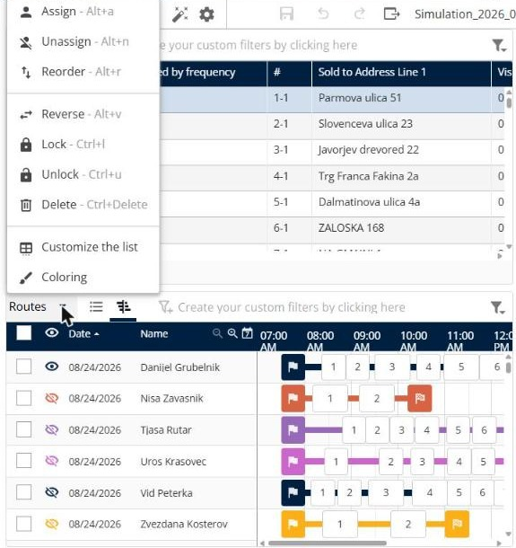
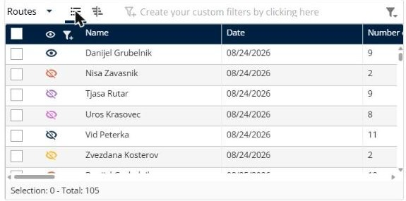

# Gérer les tournées

Cette page explique comment utiliser le panneau **Tournées** pour examiner et modifier les tournées d’une simulation.

## Avant de commencer

* Ouvrez une simulation. Voir [Simulation](simulation.md).

## Ce que vous voyez

Le panneau liste chaque tournée par livreur et par date. Dans la **Vue tournée**, vous voyez les colonnes de la liste, par exemple **Nom**, **Date** et **Nombre de livraisons**. Dans la **Vue Gantt**, vous voyez la chronologie de chaque tournée, avec le drapeau de départ, les arrêts numérotés et le drapeau d’arrivée. Les actions sur les tournées sont **Affecter**, **Désaffecter**, **Réordonner**, **Inverser**, **Verrouiller**, **Déverrouiller**, **Supprimer**, **Personnaliser la liste** et **Coloration**.

## Étapes

1. Accédez à **Simulation** > **Tournées**.
2. Cliquez sur **Vue tournée** pour voir les tournées sous forme de liste, ou sur **Vue Gantt** pour les voir sur une chronologie.
3. Cliquez sur l’icône en forme d’œil d’une tournée pour l’afficher ou la masquer sur la carte.
4. Pour ouvrir une tournée, cliquez sur sa ligne. Voir [Afficher une tournée](simulation-routes-view-route.md).
5. Pour modifier des tournées, cochez les cases des tournées à modifier.
6. Cliquez sur la flèche déroulante **Tournées**.
7. Cliquez sur une action. Chaque action est décrite dans sa propre rubrique, listée sous **Fonctionnalités**.

Chaque tournée a sa propre couleur, que vous voyez également sur la carte et dans l’icône en forme d’œil à côté de la tournée.

## Fonctionnalités

* [Afficher une tournée](simulation-routes-view-route.md) : consultez les arrêts, les horaires et les totaux d’une tournée.
* [Affecter des tournées](simulation-routes-assign.md) : affectez les tournées sélectionnées.
* [Désaffecter des tournées](simulation-routes-unassign.md) : supprimez l’affectation des tournées sélectionnées.
* [Réordonner des tournées](simulation-routes-reorder.md) : modifiez l’ordre des arrêts des tournées sélectionnées.
* [Inverser des tournées](simulation-routes-reverse.md) : inversez l’ordre des arrêts des tournées sélectionnées.
* [Verrouiller et déverrouiller des tournées](simulation-routes-lock-unlock.md) : conservez les tournées en l’état, ou rendez-les à nouveau modifiables.
* [Supprimer des tournées](simulation-routes-delete.md) : retirez les tournées sélectionnées de la simulation.
* [Personnaliser la liste des tournées](simulation-routes-customize-list.md) : choisissez les colonnes et modifiez les couleurs des tournées.

## Résultat

Chaque tournée affiche sa **Date** et son **Nom**. Dans la **Vue Gantt**, la chronologie affiche les livraisons de chaque tournée par heure. Le pied de page indique le nombre de tournées sélectionnées et le total, par exemple **Sélection : 0 - Total : 105**.

## Conseils


**Raccourcis clavier** : le menu affiche le raccourci de chaque action, par exemple **Alt+r** pour **Réordonner**, **Alt+v** pour **Inverser** et **Ctrl+l** pour **Verrouiller**.


## Rubriques connexes

* [Simulation](simulation.md)
* [Consulter les détails d’une tournée](simulation-details.md)
* [Afficher la carte](simulation-map.md)
