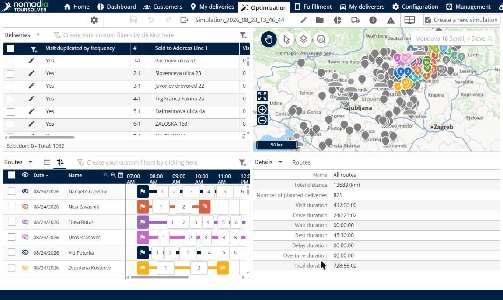
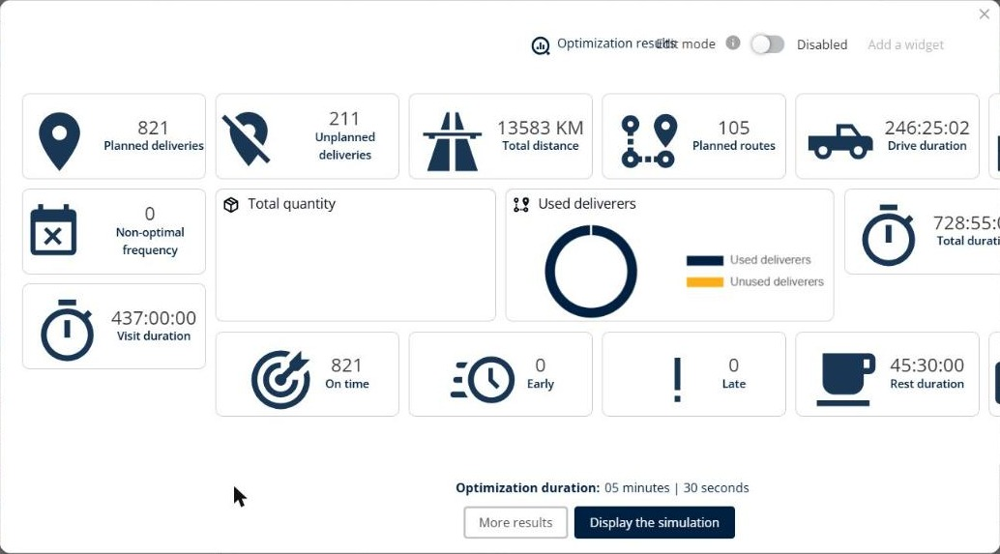

# Simulation (Français)

Le module **Simulation** affiche le résultat d’une optimisation de tournées afin que vous puissiez examiner et ajuster les tournées avant que vos livreurs ne les utilisent.


**Panneaux** : la page Simulation affiche des panneaux, et non des onglets, et chaque panneau dispose de sa propre rubrique dans ce guide. Cliquez sur **Modifier l’affichage des panneaux** pour choisir les panneaux que vous voyez.


## Avant de commencer

* Importez vos livraisons. Voir [Import of Deliveries](../importanddatasetup/importanddatasetup-importofdeliveries.md).
* Lancez une optimisation. Une simulation affiche le résultat de cette optimisation. Voir [Optimize your Deliveries](../operationsandroutemanagement/operationsandroutemanagement-optimizeyourdeliveries.md).

Pour ouvrir une simulation, accédez à **Accueil** et cliquez sur une simulation dans le tableau des simulations récentes, ou cliquez sur **Voir la liste des simulations**. La simulation s’ouvre dans l’onglet **Optimisation**.

La page comporte une barre d’outils et quatre panneaux : **Livraisons**, **Carte**, **Tournées** et **Détails**. Le nom de la simulation, par exemple **Simulation\_2026\_08\_28\_13\_46\_44**, s’affiche dans la barre d’outils.

* À gauche de la barre d’outils : **Optimiser**, **Voir et modifier les paramètres**, **Enregistrer les modifications**, **Annuler l’action**, **Refaire** et **Exporter**.
* À droite de la barre d’outils : **Modifier**, **Voir la liste des simulations**, **Résultats de l’optimisation**, **Voir les véhicules utilisés et non utilisés dans l’optimisation**, **Plus d’information**, **Modifier l’affichage des panneaux** et **Créer une nouvelle simulation**.

## Fonctionnalités

* [Gérer les livraisons](simulation-deliveries.md) : retrouvez les livraisons de la simulation et optimisez-les, affectez-les, ajoutez-les, modifiez-les, verrouillez-les ou supprimez-les.
* [Afficher la carte](simulation-map.md) : visualisez les livraisons et les tournées sur une carte et choisissez ce que la carte affiche.
* [Gérer les tournées](simulation-routes.md) : examinez, réordonnez, inversez, affectez et verrouillez les tournées.
* [Consulter les détails d’une tournée](simulation-details.md) : consultez les totaux de distance, de livraisons et de durées, ainsi que les plannings de vos livreurs.
* [Analyser les résultats](simulation-analysis.md) : accédez aux graphiques d’analyse pour mieux comprendre les résultats.

## Résultat

Lorsque vous ouvrez une simulation, la fenêtre **Résultats de l’optimisation** s’ouvre. Elle affiche **Livraisons planifiées**, **Livraisons non planifiées**, **Distance totale**, **Tournées planifiées**, **Durée de conduite**, **Durée totale**, **Durée totale travaillée**, **Durée de visite**, **À l’heure**, **En retard**, **En avance**, **Fréquence non optimale**, **Durée de repos**, **Livreurs utilisés**, **Quantité totale** et **Durée de l’optimisation**. Depuis cette fenêtre, vous pouvez cliquer sur **Plus de résultats** ou **Afficher la simulation**.

## Conseils


**Rouvrir les résultats** : cliquez sur **Résultats de l’optimisation** dans la barre d’outils pour ouvrir la fenêtre **Résultats de l’optimisation**.



**Personnaliser la fenêtre des résultats** : activez **Mode édition** dans la fenêtre **Résultats de l’optimisation**, puis cliquez sur **Ajouter un critère** pour ajouter d’autres résultats.



**Modifier la disposition des panneaux** : cliquez sur **Modifier l’affichage des panneaux**, puis faites glisser le nom d’un panneau, par exemple **Analyse**, sur la page pour l’ajouter. Cliquez sur **Annuler changement de mise en page** ou **Réinitialiser la mise en page** pour revenir en arrière.



**Simulation obsolète** : une icône d’avertissement s’affiche dans la barre d’outils lorsque votre activité a changé depuis la création de la simulation. Pour utiliser la nouvelle activité, cliquez sur l’onglet **Mes livraisons** et lancez une nouvelle optimisation.



**Déroulement type** : optimisez les livraisons, ajustez le plan avec les actions sur les livraisons et sur les tournées, vérifiez les totaux dans le panneau **Détails**, puis enregistrez la simulation.


## Rubriques connexes

* [Optimize your Deliveries](../operationsandroutemanagement/operationsandroutemanagement-optimizeyourdeliveries.md)
* [Gérer les livraisons](simulation-deliveries.md)
* [Gérer les tournées](simulation-routes.md)
