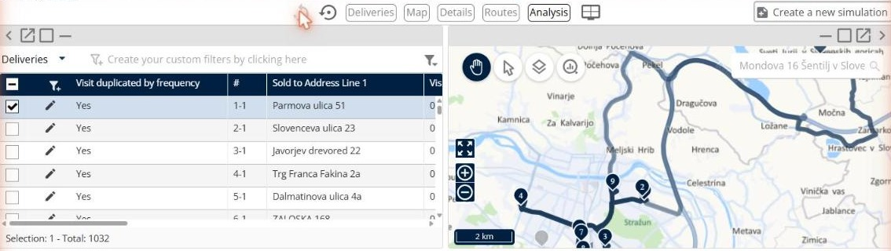

# Analyze the results

This page explains how to use the **Analysis** panel to access analysis charts and better understand the results.

## Before you begin

* Open a simulation. See [Simulation](simulation.md).

## Steps

1. Go to **Simulation**.
2. Click **Modify the display of panels**. The toolbar shows the panels you can place: **Deliveries**, **Map**, **Details**, **Routes** and **Analysis**.
3. Drag **Analysis** onto the page.

4. Click the **Analysis** drop-down arrow.
5. Click a chart.

## Result

The panel shows the chart you selected.

## Tips


**Go back to your layout**: Click **Modify the display of panels**, and then click **Undo layout changes** or **Reset layout** to remove the panel.



**Switch panels**: When you add more than one panel in the same place, click the panel name at the top right to switch between them.


## Related topics

* [Simulation](simulation.md)
* [View route details](simulation-details.md)
