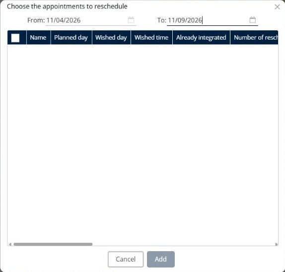

# Add appointments to reschedule

This page explains how to add appointments that need a new date to a simulation.

## When to use it

Use **Add appointments to reschedule** to plan again the visits that could not take place as planned, for example a visit that the customer postponed.

## Before you begin

* Open a simulation. See [Simulation](simulation.md).

## Steps

1. Go to **Simulation** > **Deliveries**.
2. Click the **Deliveries** drop-down arrow, and then click **Add appointments to reschedule**.
3. In the **Choose the appointments to reschedule** window, select the period in **From** and **To**, for example **11/04/2026** and **11/09/2026**.
4. Read the list of appointments. The columns include **Name**, **Planned day**, **Wished day**, **Wished time**, **Already integrated** and **Number of rescheduling**, followed by the customer fields.
5. Select the check boxes of the appointments you want to add.
6. Click **Add**.

Click **Cancel** to close the window without adding appointments.

## Result

The appointments are added to the **Deliveries** panel. Plan them with [Optimize deliveries](simulation-deliveries-optimize.md) or [Assign deliveries to a route](simulation-deliveries-assign.md).

## Tips


**Already integrated**: Use this column to see whether an appointment is already in a simulation, so that you do not plan it twice.


## Related topics

* [Manage deliveries](simulation-deliveries.md)
* [Optimize deliveries](simulation-deliveries-optimize.md)
