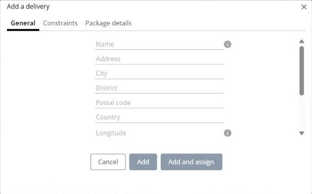
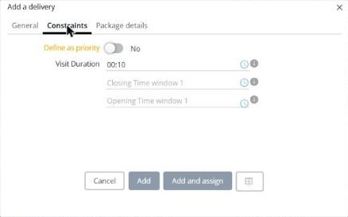

# Add a delivery

This page explains how to create a new delivery directly in a simulation.

## When to use it

Use **Add a delivery** when a customer calls in a new delivery after you optimized your routes. You add the delivery to the simulation, and then plan it with the other delivery actions.

## Before you begin

* Open a simulation. See [Simulation](simulation.md).

## Steps

1. Go to **Simulation** > **Deliveries**.
2. Click the **Deliveries** drop-down arrow, and then click **Add a delivery**. You can also press **Alt+a**.
3. On the **General** tab, enter the **Name**, **Address**, **City**, **District**, **Postal code** and **Country** of the delivery. You can also enter its **Longitude** and **Latitude**.
4. Optional: select **Add as customer** to save the delivery address in your customer list.
5. On the **Constraints** tab, set the constraints of the delivery:
   * **Define as priority**: turn on the switch to give the delivery priority.
   * **Visit Duration**: the time to spend at the customer. The default value is **00:10**.
   * **Opening Time window 1** and **Closing Time window 1**: the time window in which the delivery can take place.
6. On the **Package details** tab, read the packages of the delivery, with their **Code**, **Order** and **Description**.
7. Click **Add** to add the delivery, or **Add and assign** to add it and then assign it to a route.

Click **Cancel** to close the window without adding a delivery.

## Result

The delivery is added to the **Deliveries** panel. If you clicked **Add and assign**, the **Assign a delivery to a route** page opens. See [Assign deliveries to a route](simulation-deliveries-assign.md).

## Related topics

* [Manage deliveries](simulation-deliveries.md)
* [Change a delivery](simulation-deliveries-change-delivery.md)
* [Assign deliveries to a route](simulation-deliveries-assign.md)
