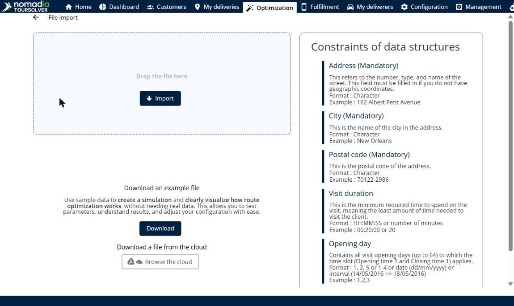

# Add a file of deliveries

This page explains how to import a file of deliveries into a simulation.

## Before you begin

* Open a simulation. See [Simulation](simulation.md).
* Prepare a file of deliveries. The **Constraints of data structures** list on the import page describes each column.

## Steps

1. Go to **Simulation** > **Deliveries**.
2. Click the **Deliveries** drop-down arrow, and then click **Add a file of deliveries**. You can also press **Alt+f**.
3. On the **File import** page, drop your file in the **Drop the file here** area, or click **Import** and select the file.
4. To import a file from your cloud storage, click **Browse the cloud**.
5. Follow the import steps to finish the import.

Click the back arrow at the top left to return to the simulation without importing a file.

## Options and fields

| Option or field | What it does | Notes |
|---|---|---|
| **Drop the file here** / **Import** | Imports your file. | |
| **Download** | Downloads an example file. | Use sample data to create a simulation and see how route optimization works, without real data. |
| **Browse the cloud** | Imports a file from your cloud storage. | |
| **Constraints of data structures** | Describes each column of the file, with its format and an example. | **Address**, **City** and **Postal code** are mandatory. The address is not needed when the file has geographic coordinates. |

## Result

The deliveries of the file are added to the **Deliveries** panel.

## Related topics

* [Manage deliveries](simulation-deliveries.md)
* [Import of Deliveries](../importanddatasetup/importanddatasetup-importofdeliveries.md)
