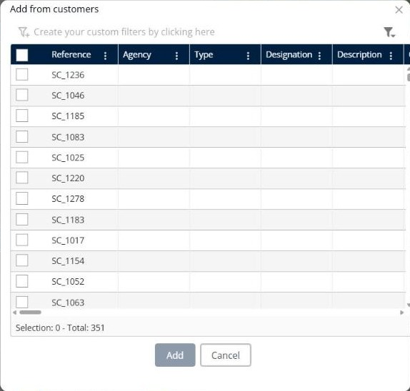

# Add from customers

This page explains how to add deliveries to a simulation from your customer list.

## Before you begin

* Open a simulation. See [Simulation](simulation.md).
* Make sure the customers exist on the **Customers** tab.

## Steps

1. Go to **Simulation** > **Deliveries**.
2. Click the **Deliveries** drop-down arrow, and then click **Add from customers**.
3. In the **Add from customers** window, find the customers. The columns include **Reference**, **Agency**, **Type**, **Designation** and **Description**. To filter the list, click **Create your custom filters by clicking here**.
4. Select the check boxes of the customers you want to add.
5. Click **Add**.

Click **Cancel** to close the window without adding deliveries.

## Result

A delivery is added to the **Deliveries** panel for each customer you selected. The footer of the window shows how many customers you selected and the total, for example **Selection: 0 - Total: 351**.

## Related topics

* [Manage deliveries](simulation-deliveries.md)
* [Add a delivery](simulation-deliveries-add-delivery.md)
