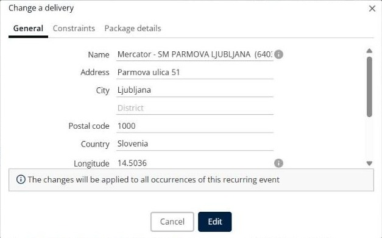

# Change a delivery

This page explains how to edit the information of a delivery in a simulation.

## Before you begin

* Open a simulation. See [Simulation](simulation.md).

## Steps

1. Go to **Simulation** > **Deliveries**.
2. Select the check box of the delivery you want to change.
3. Click the **Deliveries** drop-down arrow, and then click **Change a delivery**. You can also press **Alt+c**, or click the pencil icon at the start of the row.
4. In the **Change a delivery** window, edit the fields on the **General**, **Constraints** and **Package details** tabs. The fields are the same as in [Add a delivery](simulation-deliveries-add-delivery.md).
5. Click **Edit**.

Click **Cancel** to close the window without saving your changes.

## Result

The delivery shows your changes in the **Deliveries** panel.

## Tips


**Recurring deliveries**: For a delivery with a frequency, the message **The changes will be applied to all occurrences of this recurring event** appears. Your changes apply to every occurrence of the delivery.


## Related topics

* [Manage deliveries](simulation-deliveries.md)
* [Add a delivery](simulation-deliveries-add-delivery.md)
