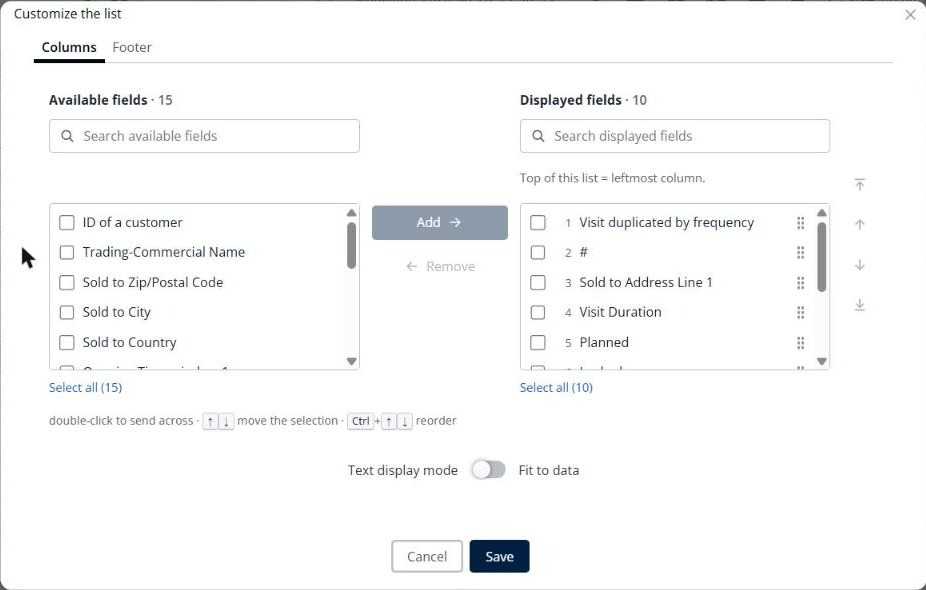

# Customize the deliveries list

This page explains how to choose the columns of the **Deliveries** panel and build your own filters.

## Before you begin

* Open a simulation. See [Simulation](simulation.md).

## Choose the columns

1. Go to **Simulation** > **Deliveries**.
2. Click the **Deliveries** drop-down arrow, and then click **Customize the list**.
3. On the **Columns** tab, select one or more fields in **Available fields**, and then click **Add**. To find a field, type its name in **Search available fields**.
4. To remove a column, select it in **Displayed fields**, and then click **Remove**.
5. To change the order of the columns, select a field in **Displayed fields**, and then click the arrows on the right, or drag the field by its handle. The top of the list is the leftmost column.
6. Optional: turn on **Text display mode** to select **Fit to data**.
7. Click **Save**.

Use the **Footer** tab to set the footer of the table. Click **Cancel** to close the window without saving.

## Filter the list

* Click **Create your custom filters by clicking here** at the top of the panel to build a custom filter.
* Click the filter icon in the header row to filter by column.

## Result

The **Deliveries** panel shows your columns and filters.

## Tips


**Keyboard shortcuts**: Double-click a field to send it to the other list. Use the up and down arrow keys to move the selection, and **Ctrl** with an arrow key to reorder the fields.


## Related topics

* [Manage deliveries](simulation-deliveries.md)
* [Color the deliveries](simulation-deliveries-coloring.md)
* [Customize the routes list](simulation-routes-customize-list.md)
