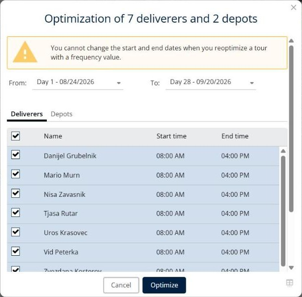
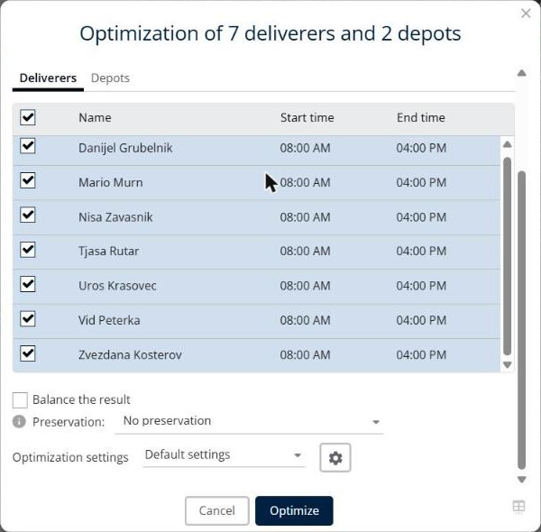

# Optimize deliveries

This page explains how to optimize the selected deliveries in a simulation.

## Before you begin

* Open a simulation. See [Simulation](simulation.md).

## When to use it

Use **Optimize** to plan the selected deliveries automatically. You choose the dates, the deliverers and the depots, you can balance the workload and keep existing routes, and you pick a settings profile.

## Steps

1. Go to **Simulation** > **Deliveries**.
2. Select the check boxes of the deliveries you want to optimize.
3. Click the **Deliveries** drop-down arrow, and then click **Optimize**. You can also click **Optimize** in the toolbar, or press **Ctrl+o**.
4. In the **Optimization of … deliverers and … depots** window, select the first and the last day of the period in **From** and **To**, for example **Day 1 - 08/24/2026** and **Day 28 - 09/20/2026**.
5. On the **Deliverers** tab, select the deliverers to use. The list shows the **Name**, **Start time** and **End time** of each deliverer. Select the check box in the header row to select all deliverers.
6. On the **Depots** tab, select the depots to use.
7. Optional: select **Balance the result**.
8. In **Preservation**, select what to keep from the current routes.
9. In **Optimization settings**, select the configuration to use, for example **Default settings**. To review or change the settings, click the gear button. See [Configure the optimization settings](simulation-optimization-settings.md).
10. Click **Optimize**.

## Options and fields

| Option or field | What it does | Notes |
|---|---|---|
| **From** and **To** | Set the first and the last day of the period. | For example **Day 1 - 08/24/2026** and **Day 28 - 09/20/2026**. |
| **Deliverers** | Lists the deliverers with their **Name**, **Start time** and **End time**. | Select the check box of each deliverer to use. The header check box selects all deliverers. |
| **Depots** | Lists the depots. | Select the depots to use. |
| **Balance the result** | Balances the workload between the deliverers. | Not selected by default. |
| **Preservation** | Chooses what to keep from the current routes: **No preservation**, **Preserve the routes** or **Preserve order of the routes**. | The default value is **No preservation**. Click the information icon for more details. |
| **Optimization settings** | Selects the settings profile to use. | The default value is **Default settings**. The gear button opens the settings. |
| **Cancel** | Closes the window without optimizing. | |
| **Optimize** | Starts the optimization. | |

## Result

The deliveries are optimized and the **Details** panel updates its totals. When the optimization finishes, the **Optimization results** window opens. See [Simulation](simulation.md).

## Tips


**Deliveries with a frequency**: You cannot change the start and end dates when you reoptimize a tour with a frequency value.



**Select deliveries first**: If no delivery is selected, the message **The action had no effect as nothing is selected.** appears.


## Related topics

* [Manage deliveries](simulation-deliveries.md)
* [Configure the optimization settings](simulation-optimization-settings.md)
* [Order a single route](simulation-deliveries-single-route-ordering.md)
