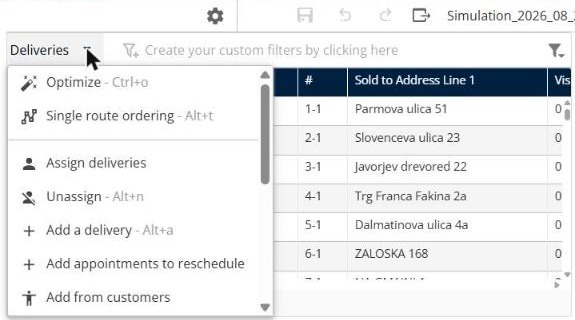
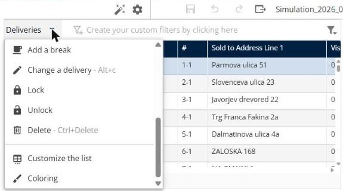

# Manage deliveries

This page explains how to use the **Deliveries** panel to find deliveries in a simulation and change how they are planned.

## Before you begin

* Open a simulation. See [Simulation](simulation.md).

## Columns

The panel shows one row for each delivery. By default the columns include **Visit duplicated by frequency**, **#**, **Sold to Address Line 1**, **Visit Duration**, **Planned**, **Locked**, **Reason**, **Assigned to**, **Planned day** and **Scheduled hour**. To choose other columns, see [Customize the deliveries list](simulation-deliveries-customize-list.md).

## Steps

1. Go to **Simulation** > **Deliveries**.
2. Click **Create your custom filters by clicking here** to filter the list.
3. Select the check boxes of the deliveries you want to change.
4. Click the **Deliveries** drop-down arrow. The menu lists **Optimize**, **Single route ordering**, **Assign deliveries**, **Unassign**, **Add a delivery**, **Add appointments to reschedule**, **Add from customers**, **Add a file of deliveries**, **Add a break**, **Change a delivery**, **Lock**, **Unlock**, **Delete**, **Customize the list** and **Coloring**.
5. Click an action. Each action is described in its own topic, listed under **Features**.

## Features

* [Optimize deliveries](simulation-deliveries-optimize.md): Optimize the selected deliveries over a period, with the deliverers you choose.
* [Order a single route](simulation-deliveries-single-route-ordering.md): Order the selected deliveries on a single route.
* [Assign deliveries to a route](simulation-deliveries-assign.md): Choose the route and the time slot for a delivery.
* [Unassign deliveries](simulation-deliveries-unassign.md): Remove the selected deliveries from their routes.
* [Add a delivery](simulation-deliveries-add-delivery.md): Create a new delivery in the simulation.
* [Add appointments to reschedule](simulation-deliveries-add-appointments-to-reschedule.md): Add appointments that need a new date to the simulation.
* [Add from customers](simulation-deliveries-add-from-customers.md): Add deliveries from your customer list.
* [Add a file of deliveries](simulation-deliveries-add-file-of-deliveries.md): Import a file of deliveries into the simulation.
* [Add a break](simulation-deliveries-add-break.md): Add a break to a route.
* [Change a delivery](simulation-deliveries-change-delivery.md): Edit the information of a delivery.
* [Lock and unlock deliveries](simulation-deliveries-lock-unlock.md): Keep deliveries as they are, or make them changeable again.
* [Delete deliveries](simulation-deliveries-delete.md): Remove the selected deliveries from the simulation.
* [Customize the deliveries list](simulation-deliveries-customize-list.md): Choose the columns and build filters.
* [Color the deliveries](simulation-deliveries-coloring.md): Apply color rules, such as one color for each deliverer.

## Result

The footer shows how many deliveries you selected and the total, for example **Selection: 2 - Total: 1032**.

## Tips


**Keyboard shortcuts**: The menu shows the shortcut of each action, for example **Ctrl+o** for **Optimize**, **Alt+t** for **Single route ordering** and **Alt+a** for **Add a delivery**.


## Related topics

* [Simulation](simulation.md)
* [Manage routes](simulation-routes.md)
* [View the map](simulation-map.md)
