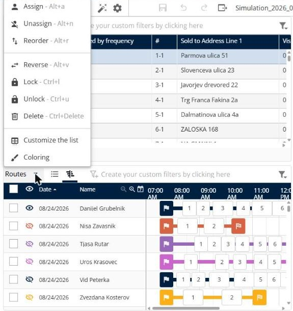
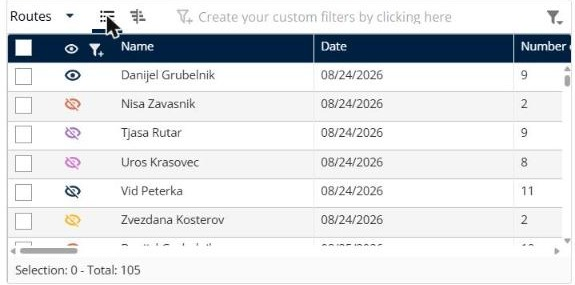

# Manage routes

This page explains how to use the **Routes** panel to review and change the routes in a simulation.

## Before you begin

* Open a simulation. See [Simulation](simulation.md).

## What you see

The panel lists each route by deliverer and date. In the list view you see the columns of the list, for example **Name**, **Date** and the number of deliveries. In the Gantt view you see the timeline of each route, with the departure flag, the numbered stops and the arrival flag. The route actions are **Assign**, **Unassign**, **Reorder**, **Reverse**, **Lock**, **Unlock**, **Delete**, **Customize the list** and **Coloring**.

## Steps

1. Go to **Simulation** > **Routes**.
2. Click the list icon to see the routes as a list, or the Gantt icon to see them on a timeline.
3. Click the eye icon of a route to show or hide it on the map.
4. To open a route, click its row. See [View a route](simulation-routes-view-route.md).
5. To change routes, select the check boxes of the routes you want to change.
6. Click the **Routes** drop-down arrow.
7. Click an action. Each action is described in its own topic, listed under **Features**.

Each route has its own color, which you also see on the map and in the eye icon next to the route.

## Features

* [View a route](simulation-routes-view-route.md): See the stops, the times and the totals of one route.
* [Assign routes](simulation-routes-assign.md): Assign the selected routes.
* [Unassign routes](simulation-routes-unassign.md): Remove the assignment of the selected routes.
* [Reorder routes](simulation-routes-reorder.md): Change the order of the stops on the selected routes.
* [Reverse routes](simulation-routes-reverse.md): Reverse the order of the stops on the selected routes.
* [Lock and unlock routes](simulation-routes-lock-unlock.md): Keep routes as they are, or make them changeable again.
* [Delete routes](simulation-routes-delete.md): Remove the selected routes from the simulation.
* [Customize the routes list](simulation-routes-customize-list.md): Choose the columns and change the route colors.

## Result

Each route shows its **Date** and **Name**. In the Gantt view, the timeline shows the deliveries of each route by hour. The footer shows how many routes you selected and the total, for example **Selection: 0 - Total: 105**.

## Tips


**Keyboard shortcuts**: The menu shows the shortcut of each action, for example **Alt+r** for **Reorder**, **Alt+v** for **Reverse** and **Ctrl+l** for **Lock**.


## Related topics

* [Simulation](simulation.md)
* [View route details](simulation-details.md)
* [View the map](simulation-map.md)
