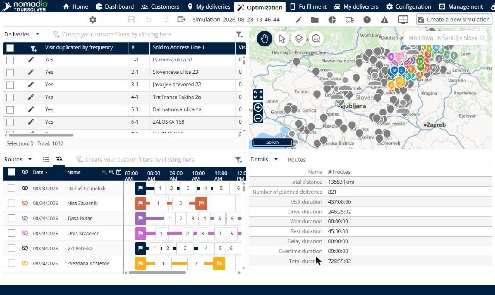
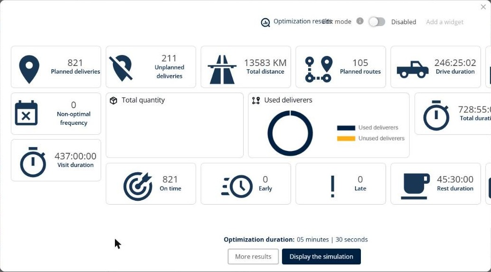

# Simulation

The **Simulation** module shows the result of a route optimization so that you can review and adjust the routes before your deliverers use them.


**Panels**: The Simulation page shows panels, not tabs, and each panel has its own topic in this guide. Click **Modify the display of panels** to choose which panels you see.


## Before you begin

* Import your deliveries. See [Import of Deliveries](../importanddatasetup/importanddatasetup-importofdeliveries.md).
* Run an optimization. A simulation shows the result of that optimization. See [Optimize your Deliveries](../operationsandroutemanagement/operationsandroutemanagement-optimizeyourdeliveries.md).

To open a simulation, go to **Home** and click a simulation in the table of recent simulations, or click **See the list of simulations**. The simulation opens on the **Optimization** tab.

The page has a toolbar and four panels: **Deliveries**, **Map**, **Routes** and **Details**. The name of the simulation, for example **Simulation\_2026\_08\_28\_13\_46\_44**, is shown in the toolbar.

* On the left of the toolbar: **Optimize**, **See and modify the settings**, **Save changes**, **Undo**, **Redo** and **Export**.
* On the right of the toolbar: **Edit**, **See the list of simulations**, **Optimization results**, **View used and unused vehicles in the optimisation**, **More information**, **Modify the display of panels** and **Create a new simulation**.

## Features

* [Manage deliveries](simulation-deliveries.md): Find the deliveries in the simulation and optimize, assign, add, change, lock or delete them.
* [View the map](simulation-map.md): See the deliveries and routes on a map and choose what the map shows.
* [Manage routes](simulation-routes.md): Review, reorder, reverse, assign and lock routes.
* [View route details](simulation-details.md): See the totals for distance, deliveries and durations, and the agendas of your deliverers.
* [Analyze the results](simulation-analysis.md): Access analysis charts to better understand the results.

## Result

When you open a simulation, the **Optimization results** window opens. It shows **Planned deliveries**, **Unplanned deliveries**, **Total distance**, **Planned routes**, **Drive duration**, **Non-optimal frequency**, **Total quantity**, **Used deliverers**, **Total duration**, **Visit duration**, **On time**, **Early**, **Late**, **Rest duration** and **Optimization duration**. From this window you can click **More results** or **Display the simulation**.

## Tips


**Open the results again**: Click **Optimization results** in the toolbar to open the **Optimization results** window.



**Customize the results window**: Turn on **Edit mode** in the **Optimization results** window, and then click **Add a widget** to add more results.



**Change the panel layout**: Click **Modify the display of panels**, then drag a panel name, for example **Analysis**, onto the page to add it. Click **Undo layout changes** or **Reset layout** to go back.



**Out-of-date simulation**: A warning icon shows in the toolbar when your activity changed after you created the simulation. To use the new activity with the same data, go to the **My deliveries** tab and start a new optimization.



**Typical workflow**: Optimize the deliveries, adjust the plan with the delivery and route actions, check the totals in the **Details** panel, and then save the simulation.


## Related topics

* [Optimize your Deliveries](../operationsandroutemanagement/operationsandroutemanagement-optimizeyourdeliveries.md)
* [Manage deliveries](simulation-deliveries.md)
* [Manage routes](simulation-routes.md)
